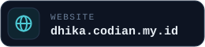

Banner animation · hide/show

  
  
  

  <i>It's not done until it's running.</i>

  <b>Full-Stack Engineer · DevOps</b> — I build full-stack web applications and APIs, with a focus on payment and messaging integrations, and the CI/CD pipelines that deploy them to Linux servers.

  <b>Open to</b> full-time roles · remote / hybrid · open-source &amp; side-project collaboration 
  <b>Based in</b> Cimahi, Indonesia · <b>Speaks</b> English, Bahasa Indonesia

## 🚀 Selected work

| Project | What it is |
|:---|:---|
| **[PaymentKit](https://github.com/dhikaagh/paymentkit)** | A payment API with asynchronous processing, containerized services, and a GitHub Actions deployment workflow. **My contribution:** API/worker development and the GitHub Actions deployment workflow. `TypeScript` `Hono` `RabbitMQ` `MySQL` `Docker` `Actions` |
| **[Messaging Bridge](https://github.com/dhikaagh/Messaging-Bridge-)** | An API for integrating Telegram, email, and WhatsApp messaging. **My contribution:** API routing and OpenAPI documentation. `TypeScript` `Bun` `Hono` `Zod` |

## 🧭 What I do

| Area | Work |
|:---|:---|
| **Full&#8209;stack** | Build web applications across the frontend and backend. Design REST APIs with OpenAPI documentation and asynchronous processing with RabbitMQ. |
| **DevOps** | Build CI/CD pipelines with GitHub Actions and GitLab CI/CD. Ship containerized deployments to VPS over SSH with Docker Compose, with post-deploy health checks and staging environments. Manage Linux servers for the applications I deploy. |

## 🛠️ Tech stack

| Category | Technologies |
|:---|:---|
| **Languages** |    |
| **Frontend** |    |
| **Backend** |    |
| **Data & messaging** |    |
| **DevOps & tools** |      |

## 📊 GitHub Stats

  <picture>
    <source media="(prefers-color-scheme: dark)" srcset="https://github-profile-summary-cards.vercel.app/api/cards/profile-details?username=dhikaagh&amp;theme=github_dark" />
    
  </picture>

  <picture>
    <source media="(prefers-color-scheme: dark)" srcset="https://github-profile-summary-cards.vercel.app/api/cards/stats?username=dhikaagh&amp;theme=github_dark" />
    
  </picture>
  <picture>
    <source media="(prefers-color-scheme: dark)" srcset="https://github-profile-summary-cards.vercel.app/api/cards/repos-per-language?username=dhikaagh&amp;theme=github_dark" />
    
  </picture>

Languages by repository count, not skill level.

  <picture>
    <source media="(prefers-color-scheme: dark)" srcset="https://streak-stats.demolab.com?user=dhikaagh&amp;theme=github-dark-blue&amp;hide_border=true" />
    
  </picture>

## 🐍 Contribution Activity

Contribution activity · hide/show

  <picture>
    <source media="(prefers-color-scheme: dark)" srcset="https://raw.githubusercontent.com/dhikaagh/dhikaagh/output/github-contribution-grid-snake-dark.svg?palette=github-dark" />
    
  </picture>

